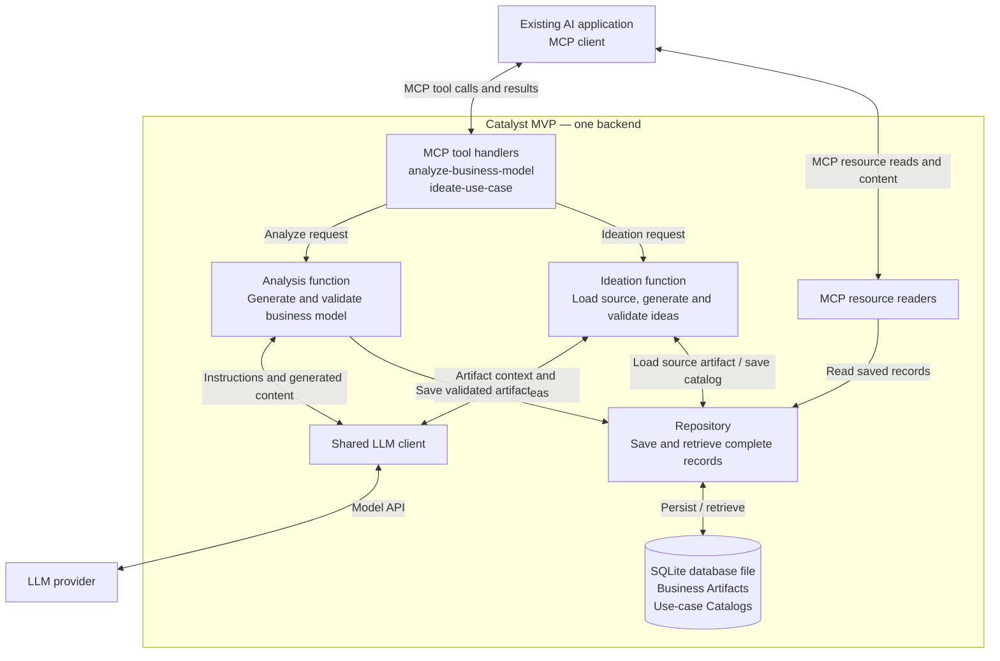

# Catalyst MVP system design

Status: implementation design for the two-tool MVP. Business Artifact schemas and their contract tests are implemented. MCP integration, Catalog schemas, persistence, Markdown views and generation remain proposed work.

See [Product scope and requirements](PROJECT_CONTEXT.md) for the product contracts, scope and open choices. This document recommends implementation details, including create-only records, optional input focus, string-array entries, alignment objects and generation limits. These details remain proposals unless explicitly recorded as implementation decisions below.

## 1. Goal and operating model

Implement this complete path:

**Business content text → analyze-business-model → saved Business Artifact → ideate-use-case → saved Use-case Catalog.**

Use an existing MCP-capable AI application as the interface. Build one local Python backend using the official MCP SDK, Pydantic for strict validation, one LLM-provider adapter, and a SQLite database file. The backend makes the analysis and ideation model calls. Start with local stdio transport and synchronous request/result operations; the implementation can use async I/O internally.

These are modules in one application, not separately deployed services.



The backend assigns record IDs and metadata, validates content, and manages storage. MCP supplies the interface for tool calls and resource reads. The official [server-building guide](https://modelcontextprotocol.io/docs/develop/build-server) describes the server/client integration.

## 2. MVP scope and creation semantics

- Accept business content as text. PDF/PPT extraction is a separate input-preparation step.
- Expose exactly the two tools in the contract and resource readers for the objects they save.
- Provide JSON and Markdown representations of both saved object types. Markdown availability is part of the MVP; clients can choose which representation to read.
- Preserve the MVP success payloads below. Do not require additional ownership, revision, approval, evidence or hierarchy fields.
- Each successful analysis creates a new artifact ID. Each successful ideation creates a new catalog ID.
- Saved records are immutable through this MVP interface. Repeated calls create new records rather than updating earlier ones.
- At creation, `createdAt` and `updatedAt` have the same UTC timestamp. Resource reads do not change either field.

Create-only records keep `sourceArtifact.id` and element alignment stable without introducing revisions. Repeating a request can create another record; retry deduplication is not part of this initial contract. Future editing and hierarchy propagation require a subsequent design change.

## 3. Tool contracts

### analyze-business-model

Input:

```json
{
  "businessContent": "Business content as text"
}
```

`businessContent` is required and must contain non-whitespace text. Apply a configurable size limit rather than silently truncating the input.

Success output is the complete saved Business Artifact:

```text
id: string
name: string
uri: string
createdAt: UTC timestamp
updatedAt: UTC timestamp
businessModel:
  endUsers: string[]
  economicBuyers: string[]
  decisionMakers: string[]
  solutions: string[]
  benefits: string[]
  channels: string[]
  relationships: string[]
  businessResources: string[]
  activities: string[]
  partnerships: string[]
  revenuesAndAdvantages: string[]
  costsAndRisks: string[]
```

All 12 sections are present. Unspecified sections contain empty arrays. Strings contain individual business-model statements. The analysis instructions require source-supported content and must not request fabricated entries to fill empty sections.

The LLM generates only `name` and `businessModel`. The backend assigns `id`, `uri`, `createdAt` and `updatedAt` after validating the generated content.

#### Recorded Business Artifact schema decisions (step 2)

- Use strict Pydantic 2 models with extra fields forbidden at every object level. Preserve the documented field names directly, including `businessContent` and `businessModel`.
- Require all 12 business-model sections as arrays of non-blank strings. Do not fill missing fields automatically. An empty array represents an unspecified section, but an entirely empty model is invalid.
- Require non-whitespace content for input text, names, IDs, URIs and section statements. Preserve accepted text and array order; validation does not trim, summarize or normalize business content.
- Separate analysis input, generated content and the complete Business Artifact. Generated content cannot supply IDs, URIs or timestamps. The complete artifact requires every metadata field; these schemas do not generate metadata or persist records.
- Validate the artifact URI against its ID using `catalyst://business-artifact/{id}`. Require timezone-aware timestamps with a zero UTC offset and equal `createdAt` and `updatedAt` values for create-only artifacts.
- Use Python `datetime` objects when constructing complete artifacts in backend code. Use `model_validate_json` for JSON timestamp strings and `model_dump_json` or `model_dump(mode="json")` for JSON serialization.
- Leave configurable input-size enforcement to the later analysis workflow. These schemas validate structure and content presence; they do not verify source support or business relevance.

### ideate-use-case

Input:

```json
{
  "artifactId": "ba_001",
  "numberOfIdeas": 3,
  "focus": "Customer support efficiency"
}
```

Recommended initial input rules:

- `artifactId`: required identifier of an existing saved artifact.
- `numberOfIdeas`: required integer; use a configurable initial range of 1–10.
- `focus`: optional text. If omitted, consider the whole business model.

Success output is the complete saved catalog:

```text
id: string
createdAt: UTC timestamp
updatedAt: UTC timestamp
sourceArtifact:
  id: string
useCases:
  - id: string
    title: string
    focus: string
    problem: string
    targetUsers: string[]
    proposedSolution: string
    businessElementAlignment: alignment[]
```

The LLM generates the use-case content fields. The backend generates the catalog ID and case IDs, sets timestamps, and copies the input artifact ID into `sourceArtifact.id`.

The tool loads the artifact from the repository. It does not rely on the host to recreate or resend its business model from conversation history. The requested focus constrains generation; each returned case has a specific focus label within that scope.

### Proposed businessElementAlignment structure

The output contract includes an alignment array. The proposed structure for each entry is:

```json
{
  "section": "activities",
  "element": "Handle customer support requests",
  "rationale": "Helps the support team route requests to the appropriate staff."
}
```

This is an illustrative example, valid only when the quoted activity exists in the source artifact.

Validation rules:

1. `section` is one of the exact 12 `businessModel` keys.
2. `element` exactly matches a string in the selected source section.
3. `rationale` is a non-empty explanation.
4. Every use case has at least one valid alignment entry.

These checks establish a real reference. Whether the rationale is commercially convincing still requires quality evaluation; structural validation alone does not establish that.

## 4. MCP result and resource behavior

Implement against the protocol version supported by the selected SDK and host. The draft specification links below are references, not version pins.

Return the full saved domain object in the tool result's `structuredContent`, conforming to its `outputSchema`. Also provide the serialized JSON in a text content block for client compatibility. These are MCP transport fields around the domain payload, not extra fields inside the Business Artifact or Catalog. See the [tool result specification](https://modelcontextprotocol.io/specification/draft/server/tools).

### Resource representations and discovery

Each saved object has two representations:

| Object | Resource URI | MIME type |
|---|---|---|
| Business Artifact JSON | `catalyst://business-artifact/{id}` | `application/json` |
| Business Artifact Markdown | `catalyst://business-artifact/{id}/view.md` | `text/markdown` |
| Use-case Catalog JSON | `catalyst://use-case-catalog/{id}` | `application/json` |
| Use-case Catalog Markdown | `catalyst://use-case-catalog/{id}/view.md` | `text/markdown` |

These four URI patterns cover two stored object types. The `/view.md` suffix identifies a representation and does not refer to a separate file on disk.

- The artifact's `uri` output field remains its canonical JSON URI.
- Compute the catalog's URIs and both Markdown URIs in the MCP layer without adding domain fields.
- Include two native MCP `resource_link` entries in each successful tool result, one for JSON and one for Markdown, with distinguishable names and the corresponding MIME types. The full domain object in `structuredContent` remains unchanged.
- Resource listing advertises both representations of each saved object. Catalog display names can be derived from their IDs or source-artifact names; include the format in each display name.
- A JSON read returns the saved domain object serialized as JSON. A Markdown read formats the same saved object as Markdown text.
- Both resource-read paths use the repository and never call the LLM, modify the saved record, or change its timestamps.
- Host support determines whether Markdown is displayed with formatting or as plain text. A custom UI is not required.

### Markdown rendering

Use two deterministic functions in `markdown_views.py`, one for each object type. Load the saved JSON, render it with fixed templates, and return the text through the Markdown resource reader. Do not persist a second copy of the record as a Markdown file.

| View | Required content |
|---|---|
| Business Artifact | Name, ID, canonical JSON URI, timestamps and all 12 business-model sections |
| Use-case Catalog | Catalog ID, timestamps, source artifact ID and URI, plus every use case's ID, title, focus, problem, target users, proposed solution and alignment entries |

Preserve the complete stored content and array order. Use a fixed order for the 12 business-model sections, label empty sections as "Not specified," and include every alignment entry's section, element and rationale. Do not summarize or infer new facts. The catalog's source artifact URI is computed from `sourceArtifact.id`.

Treat stored strings as document content and escape Markdown syntax or HTML where necessary to preserve the template structure. Rendering must not introduce raw active HTML or interpret stored text as instructions. Repeated reads of the same saved record with the same renderer version must produce the same Markdown. Do not add a current-time rendering timestamp.

MCP exposes content identified by URI through resource reads; storage remains the application's responsibility. See the [resource specification](https://modelcontextprotocol.io/specification/draft/server/resources).

## 5. Persistence

Use two tables:

| Table | Columns |
|---|---|
| `business_artifacts` | `id` primary key, `payload_json` containing the complete artifact |
| `use_case_catalogs` | `id` primary key, `source_artifact_id` foreign key, `payload_json` containing the complete catalog |

The repository ensures that row identifiers and the identifiers inside the JSON agree. `source_artifact_id` equals the payload's `sourceArtifact.id`.

Enable SQLite foreign-key enforcement on each connection. This protects the catalog-to-artifact association. See [SQLite foreign-key support](https://sqlite.org/foreignkeys.html).

Generate and validate outside the write transaction. Save each complete result atomically after validation succeeds. Return success only after the commit succeeds. Configure the database as a persistent file, not an in-memory or temporary database.

Store each domain record once as JSON. The Markdown representation is derived on demand and requires no additional database table or stored document.

## 6. Request execution

### Analysis request

1. Host calls `analyze-business-model` with business text.
2. Handler validates the input and invokes the analysis function.
3. Analysis function asks the model for `name` and the 12-section `businessModel`.
4. Validate strict types, allowed fields and usable content. Reject an entirely empty business model as insufficient input.
5. Backend adds metadata and builds the full artifact.
6. Repository saves it in one transaction.
7. Return the same saved artifact to the host.

### Ideation request

1. Host calls `ideate-use-case` with artifact ID, number of ideas and optional focus.
2. Validate the arguments and load the saved source artifact. Stop before generation if the ID is unknown.
3. Supply the source model, requested count and focus to the model.
4. Validate the idea structure, requested count, and every alignment reference.
5. Backend assigns case IDs, catalog ID, timestamps and `sourceArtifact.id`.
6. Repository saves the full catalog and its source association atomically.
7. Return the same saved catalog to the host.

The host invokes the tools separately. Creating an artifact does not itself trigger ideation.

### Resource read

1. Resolve the requested object type, ID and representation from the resource URI.
2. Load the complete saved record. Return the appropriate resource-read error for an unknown ID or unsupported URI.
3. For the canonical URI, serialize the object as JSON with MIME type `application/json`.
4. For the `/view.md` URI, render the complete object with the appropriate Markdown template and MIME type `text/markdown`.
5. Return content identified by the requested URI without saving changes or calling the model.

## 7. Validation and failure behavior

Configure strict Pydantic models with extra fields forbidden. Use separate generated-content models and final saved-object models, so the LLM is not responsible for system metadata. Pydantic supplies model validation and schema support; see its [model documentation](https://docs.pydantic.dev/latest/concepts/models/).

| Condition | Behavior |
|---|---|
| Empty or oversized text | Return a clear input error |
| Unknown artifact ID | Return a not-found error before calling the model |
| Invalid count or focus type | Return a clear validation error |
| Entirely empty extracted model | Return an insufficient-business-content error |
| Malformed model result, wrong count, or invalid alignment | Allow at most one corrective generation attempt; fail if still invalid |
| Provider timeout or failure | Return a clear execution error; save no domain result |
| Database save failure | Roll back; return an execution error |
| Unknown resource URI/ID | Return the appropriate resource-read error consistently for JSON and Markdown |
| Markdown rendering failure | Return a resource-read execution error without changing the saved record |

Provider timeouts and input limits are configuration values. Do not silently return fewer ideas than requested. Execution failures use the SDK's MCP error mechanisms; these failure paths do not add fields to the success schemas.

For local stdio, send application logs to stderr so stdout remains available for MCP messages. This follows the [official server guidance](https://modelcontextprotocol.io/docs/develop/build-server). Log operation, duration, record IDs and failure category; avoid dumping full business inputs or provider secrets.

## 8. Proposed project structure

```text
src/
  catalyst_mcp/
    __init__.py            Package entry point
    server.py              MCP registration and thin handlers
    models.py              Input, generated-content and saved-object schemas
    services.py            Analysis and ideation workflows
    llm_client.py          One provider adapter with typed JSON generation
    repository.py          SQLite reads and atomic writes
    markdown_views.py      Deterministic views of saved artifacts and catalogs
    settings.py            Model, API key, database path and request limits
    prompts/
      analyze_business_model.md
      ideate_use_case.md
tests/
  fixtures/                Synthetic business briefs and generated records
  test_models.py           Business Artifact schema and validation tests
  test_analysis.py
  test_ideation.py
  test_repository.py
  test_markdown_views.py
  test_mcp_flow.py
```

The package entry point, Business Artifact models in `models.py`, and their tests in `test_models.py` currently exist. The other modules and test files above are proposed additions. Test examples currently live directly in `test_models.py`; no fixtures directory has been added.

The prompt files contain backend generation instructions. They are not separately registered MCP Prompts in this MVP.

## 9. Build order and completion criteria

1. Encode the MVP schemas and a synthetic reference business brief. Resolve the proposed contract details before publishing a stable API.
2. Implement repository writes, reads and persistence across restart using fixed valid objects.
3. Implement the two deterministic Markdown renderers. Register the two tools and all JSON/Markdown resource routes with a deterministic fake provider, then verify discovery and reads through the MCP interface.
4. Implement real analysis generation, validation, persistence and tool output through the configurable provider adapter.
5. Implement real ideation from a saved artifact, including alignment validation.
6. Exercise the complete path with representative synthetic briefs and verify integration with the selected host. Distinguish fake-provider, live-model and host-integration results.

The MVP is complete when:

- Both tools are discoverable and callable from the selected host.
- Analysis returns exactly the simplified artifact shape and saves it.
- JSON resource reads reproduce the saved content after a server restart.
- Markdown views of both object types are discoverable, readable after restart, and returned as `text/markdown`.
- Markdown includes all stored fields, all 12 model sections and every use case without truncation or summarization; empty sections are explicit.
- Repeated Markdown reads are deterministic for a given record and renderer version, preserve special characters as content, make no model calls, and change no data or timestamps.
- Each successful tool result exposes links to both representations without changing its domain output schema.
- Ideation returns exactly the requested number of valid case ideas.
- Each case has machine-checkable links to the correct source model and a useful alignment explanation.
- Catalogs cannot be associated with a nonexistent source artifact.
- Invalid generations and failed writes do not create partial records or misleading success results.
- Manual checks on reference briefs find useful business extraction and relevant ideas. Passing schema validation is evaluated separately from business quality.
