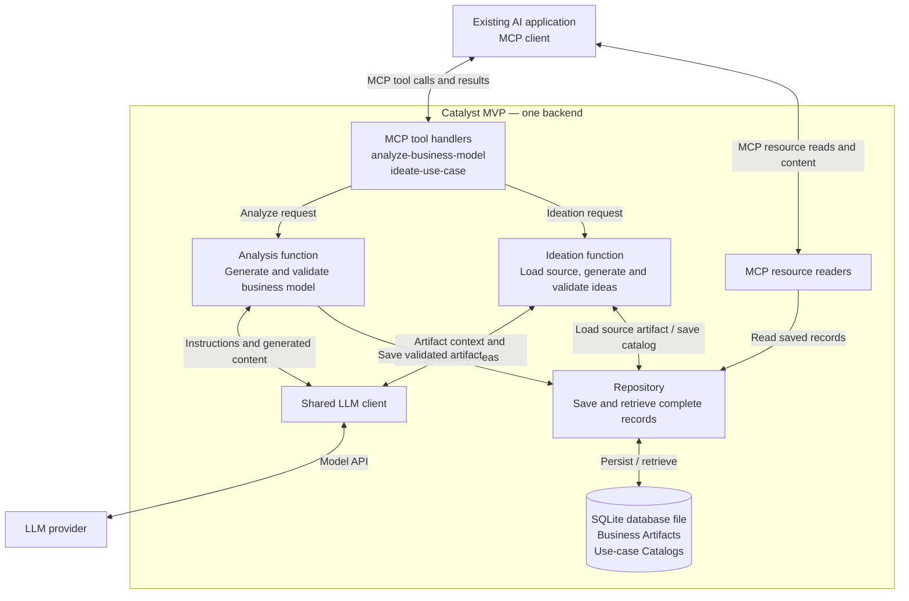

# Catalyst MVP system design

Status: implementation design for the two-tool MVP. Business Artifact and Use-case Catalog schemas, SQLite persistence, deterministic Markdown rendering and both generation workflows with scripted fake providers are implemented and tested. Both tools, canonical JSON and Markdown resource listing/reads, and links to both views are exposed over local MCP stdio, including restart verification. OpenAI, Anthropic and local Ollama JSON transports, environment settings and provider selection are implemented with mocked-HTTP verification. Both prompt/runtime integrations are implemented with mocked-HTTP checks; live-model behavior and selected-host integration are unverified.

See [Product scope and requirements](PROJECT_CONTEXT.md) for the product contracts, scope and open choices. This document recommends implementation details, including create-only records, optional input focus, string-array entries, alignment objects and generation limits. These details remain proposals unless explicitly recorded as implementation decisions below.

## 1. Goal and operating model

Implement this complete path:

**Business content text → analyze-business-model → saved Business Artifact → ideate-use-case → saved Use-case Catalog.**

Use an existing MCP-capable AI application as the interface. Build one local Python backend using the official MCP SDK, Pydantic for strict validation, one LLM-provider adapter, and a SQLite database file. The backend makes the analysis and ideation model calls. Start with local stdio transport and synchronous request/result operations; the implementation can use async I/O internally.

These are modules in one application, not separately deployed services.



The backend assigns record IDs and metadata, validates content, and manages storage. MCP supplies the interface for tool calls and resource reads. The official [server-building guide](https://modelcontextprotocol.io/docs/develop/build-server) describes the server/client integration.

## 2. MVP scope and creation semantics

- Accept business content as text. PDF/PPT extraction is a separate input-preparation step.
- Expose exactly the two tools in the contract and resource readers for the objects they save.
- Provide JSON and Markdown representations of both saved object types. Markdown availability is part of the MVP; clients can choose which representation to read.
- Preserve the MVP success payloads below. Do not require additional ownership, revision, approval, evidence or hierarchy fields.
- Each successful analysis creates a new artifact ID. Each successful ideation creates a new catalog ID.
- Saved records are immutable through this MVP interface. Repeated calls create new records rather than updating earlier ones.
- At creation, `createdAt` and `updatedAt` have the same UTC timestamp. Resource reads do not change either field.

Create-only records keep `sourceArtifact.id` and element alignment stable without introducing revisions. Repeating a request can create another record; retry deduplication is not part of this initial contract. Future editing and hierarchy propagation require a subsequent design change.

## 3. Tool contracts

### analyze-business-model

Input:

```json
{
  "businessContent": "Business content as text"
}
```

`businessContent` is required and must contain non-whitespace text. Apply a configurable size limit rather than silently truncating the input.

Success output is the complete saved Business Artifact:

```text
id: string
name: string
uri: string
createdAt: UTC timestamp
updatedAt: UTC timestamp
businessModel:
  endUsers: string[]
  economicBuyers: string[]
  decisionMakers: string[]
  solutions: string[]
  benefits: string[]
  channels: string[]
  relationships: string[]
  businessResources: string[]
  activities: string[]
  partnerships: string[]
  revenuesAndAdvantages: string[]
  costsAndRisks: string[]
```

All 12 sections are present. Unspecified sections contain empty arrays. Strings contain individual business-model statements. The analysis instructions require source-supported content and must not request fabricated entries to fill empty sections.

The LLM generates only `name` and `businessModel`. The backend assigns `id`, `uri`, `createdAt` and `updatedAt` after validating the generated content.

#### Recorded Business Artifact schema decisions (step 2)

- Use strict Pydantic 2 models with extra fields forbidden at every object level. Preserve the documented field names directly, including `businessContent` and `businessModel`.
- Require all 12 business-model sections as arrays of non-blank strings. Do not fill missing fields automatically. An empty array represents an unspecified section, but an entirely empty model is invalid.
- Require non-whitespace content for input text, names, IDs, URIs and section statements. Preserve accepted text and array order; validation does not trim, summarize or normalize business content.
- Separate analysis input, generated content and the complete Business Artifact. Generated content cannot supply IDs, URIs or timestamps. The complete artifact requires every metadata field; these schemas do not generate metadata or persist records.
- Validate the artifact URI against its ID using `catalyst://business-artifact/{id}`. Require timezone-aware timestamps with a zero UTC offset and equal `createdAt` and `updatedAt` values for create-only artifacts.
- Use Python `datetime` objects when constructing complete artifacts in backend code. Use `model_validate_json` for JSON timestamp strings and `model_dump_json` or `model_dump(mode="json")` for JSON serialization.
- Keep configurable input-size enforcement in the analysis workflow, implemented in step 8. These schemas validate structure and content presence; they do not verify source support or business relevance.

### ideate-use-case

Input:

```json
{
  "artifactId": "ba_001",
  "numberOfIdeas": 3,
  "focus": "Customer support efficiency"
}
```

Recommended initial input rules:

- `artifactId`: required identifier of an existing saved artifact.
- `numberOfIdeas`: required integer; use a configurable initial range of 1–10.
- `focus`: optional text. If omitted, consider the whole business model.

Success output is the complete saved catalog:

```text
id: string
createdAt: UTC timestamp
updatedAt: UTC timestamp
sourceArtifact:
  id: string
useCases:
  - id: string
    title: string
    focus: string
    problem: string
    targetUsers: string[]
    proposedSolution: string
    businessElementAlignment: alignment[]
```

The LLM generates the use-case content fields. The backend generates the catalog ID and case IDs, sets timestamps, and copies the input artifact ID into `sourceArtifact.id`.

The tool loads the artifact from the repository. It does not rely on the host to recreate or resend its business model from conversation history. The requested focus constrains generation; each returned case has a specific focus label within that scope.

#### Recorded ideation and Catalog schema decisions (step 3)

- Require a non-blank `artifactId` and a strictly positive integer `numberOfIdeas`. Reject booleans, numeric strings and floats as counts. Step 9 enforces the configurable maximum, defaulting to 10, in the workflow rather than as a fixed schema bound.
- Allow input `focus` to be omitted or `null`. If text is supplied, require non-whitespace content and preserve it unchanged. The focus field on each generated or complete use case remains required non-blank text.
- Require all six use-case content fields. `targetUsers` is an array of non-blank strings and may be empty; `businessElementAlignment` is an array with at least one entry. Each alignment requires `section`, `element` and `rationale`; `section` is one of the exact 12 business-model keys, and the other fields are non-blank strings.
- Represent generated ideation content as an object containing only a non-empty `useCases` array. Generated cases cannot supply IDs; generated catalogs cannot supply metadata or a source association.
- A complete use case adds a required backend-supplied `id` to the content fields. A complete Catalog requires `id`, timezone-aware UTC `createdAt` and `updatedAt`, `sourceArtifact` containing only its `id`, and a non-empty `useCases` array. Require equal creation timestamps and unique case IDs within the catalog.
- Forbid unknown fields at every object level, including a Catalog `uri` field. Preserve supplied content and array order. These models validate supplied metadata; they do not assign it or save records.
- Source existence, exact alignment-element matches and the exact requested idea count require the request and saved source artifact. Step 9 checks these in the ideation workflow. Shape validation alone does not establish source support, business relevance or compliance with a requested focus.

### businessElementAlignment structure

The output contract includes an alignment array. The adopted structure for each entry is:

```json
{
  "section": "activities",
  "element": "Handle customer support requests",
  "rationale": "Helps the support team route requests to the appropriate staff."
}
```

This is an illustrative example, valid only when the quoted activity exists in the source artifact.

Validation rules:

1. `section` is one of the exact 12 `businessModel` keys.
2. `element` exactly matches a string in the selected source section.
3. `rationale` is a non-empty explanation.
4. Every use case has at least one valid alignment entry.

These checks establish a real reference. Whether the rationale is commercially convincing still requires quality evaluation; structural validation alone does not establish that.

## 4. MCP result and resource behavior

Implement against the protocol version supported by the selected SDK and host. The draft specification links below are references, not version pins.

Return the full saved domain object in the tool result's `structuredContent`, conforming to its `outputSchema`. Also provide the serialized JSON in a text content block for client compatibility. These are MCP transport fields around the domain payload, not extra fields inside the Business Artifact or Catalog. See the [tool result specification](https://modelcontextprotocol.io/specification/draft/server/tools).

### Recorded analysis MCP decisions (step 10)

- Step 10 was authorized before step 9. It adds only analysis discovery and execution; step 9 adds the ideation service and step 11 exposes it through MCP.
- Select the official `mcp>=2.3.0,<3` dependency without CLI extras, recording the resolved version in `uv.lock`. Verify against the current [official SDK documentation](https://py.sdk.modelcontextprotocol.io/) and installed APIs.
- Use the SDK's [low-level `Server`](https://py.sdk.modelcontextprotocol.io/advanced/low-level-server/) with `on_list_tools` and `on_call_tool` handlers in `server.py`. This allows reuse of the exact existing Pydantic input/output schemas and explicit strict argument validation, without the convenience layer's generated argument model or private SDK changes.
- At step 10, advertise only `analyze-business-model`; step 11 adds ideation. The analysis input is `businessContent`; reject unknown fields and invalid types. Advertise and enforce the service's default 20,000-character limit before generation, sharing that default as a named constant in `services.py`.
- Run the synchronous analysis service in `asyncio.to_thread`. Return the complete committed artifact in `structuredContent` and serialized JSON text, with the existing payload unchanged. Resource handlers and links remain steps 12 and 13.
- Return input and execution failures as `CallToolResult(is_error=True)` with fixed messages and no structured success payload. Distinguish invalid input, oversized input, unusable business content, timeouts, database errors and other execution failures without echoing rejected values, business text or provider exception details. Log only fixed failure summaries and successful record IDs to stderr.
- Step 10 replaces the greeting command with an argparse entry point initially requiring `--database PATH` and one or more `--fake-response PATH` arguments. Read the files as UTF-8 and pass their contents to the existing scripted fake. Each provider call consumes one file in order, including correction attempts; exhausted scripts fail explicitly. Step 11 makes the response scripts optional and adds the independent ideation option below. This remains development-only configuration, with no default canned result, real adapter, environment settings or provider deadline enforcement.
- Start stdio using the SDK's `stdio_server` and `Server.run` under `asyncio.run`. Importing the package or server must not start it, open a database or write output. CLI startup diagnostics and application logs use stderr; stdout carries MCP messages while serving.
- Verify exact discovery/result shapes and failures with the official SDK client in process, then verify initialization, discovery, calls, persistence across server restart and clean JSON-RPC stdout through the actual console command. These are local protocol checks with a fake provider, separate from live-model and selected-host integration checks.

### Recorded two-tool MCP decisions (step 11)

- Extend the existing SDK `Server` with exactly `analyze-business-model` and `ideate-use-case`, in that order. Inject the analysis and ideation providers explicitly and reuse the same repository. Keep separate small analysis/ideation handlers behind name-based dispatch.
- Derive the ideation input/output schemas from `IdeateUseCaseInput` and `UseCaseCatalog`. Advertise and enforce the service's default maximum of 10 ideas before generation. Preserve optional/null focus, strict types and unknown-field rejection. Return the entire committed Catalog in `structuredContent` and matching JSON text, without a Catalog URI field or resource links.
- Refine the service's missing-source exception to `SourceArtifactNotFoundError`, a `LookupError` subclass. This preserves the step 9 exception contract while allowing the MCP handler to distinguish missing sources from provider-raised lookup errors. Keep fixed messages for invalid input, missing sources, timeouts, database errors and other execution failures, with `is_error=True` and no structured success payload.
- Make `_tool_error` take the known operation name so stderr logs identify the correct tool without echoing untrusted tool names, arguments or provider details. Successful logs include only the operation and record ID. Continue running synchronous service calls with `asyncio.to_thread` and reserve stdout for MCP messages.
- Keep `--fake-response` for analysis and add repeatable `--fake-ideation-response` for ideation. Each supplies an independent ordered script, including corrective calls. Both options are optional; an omitted or exhausted script fails when that provider is called, without affecting the other script. This permits ideation-only startup against a saved artifact. `--database` stays required, and unreadable response files fail startup before opening the database.
- Verify discovery, complete results, strict inputs, source handling, independent scripts, correction bounds and failure atomicity with the official SDK client and real temporary SQLite. Exercise the full two-tool sequence and ideation after a process restart through the actual stdio command, checking every stdout line as JSON-RPC and source/Catalog persistence.
- Step 11 exposes the fake-provider workflows. Steps 12 and 13 add JSON/Markdown listing, reads and links; step 14a adds the OpenAI transport below. Prompt integration, overall deadline enforcement and selected-host verification remain later work.

### Resource representations and discovery

Each saved object has two representations:

| Object | Resource URI | MIME type |
|---|---|---|
| Business Artifact JSON | `catalyst://business-artifact/{id}` | `application/json` |
| Business Artifact Markdown | `catalyst://business-artifact/{id}/view.md` | `text/markdown` |
| Use-case Catalog JSON | `catalyst://use-case-catalog/{id}` | `application/json` |
| Use-case Catalog Markdown | `catalyst://use-case-catalog/{id}/view.md` | `text/markdown` |

These four URI patterns cover two stored object types. The `/view.md` suffix identifies a representation and does not refer to a separate file on disk.

- The artifact's `uri` output field remains its canonical JSON URI.
- Compute the catalog's URIs and both Markdown URIs in the MCP layer without adding domain fields.
- Include two native MCP `resource_link` entries in each successful tool result, one for JSON and one for Markdown, with distinguishable names and the corresponding MIME types. The full domain object in `structuredContent` remains unchanged.
- Resource listing advertises both representations of each saved object. Catalog display names can be derived from their IDs or source-artifact names; include the format in each display name.
- A JSON read returns the saved domain object serialized as JSON. A Markdown read formats the same saved object as Markdown text.
- Both resource-read paths use the repository and never call the LLM, modify the saved record, or change its timestamps.
- Host support determines whether Markdown is displayed with formatting or as plain text. A custom UI is not required.

### Recorded JSON resource decisions (step 12)

- Add `on_list_resources` and `on_read_resource` to the existing SDK `Server` in `server.py`. Verify the resource types and callbacks against the [official SDK API](https://py.sdk.modelcontextprotocol.io/servers/resources/) and installed MCP 2.3.0. No dependency or domain-payload changes are needed.
- List one JSON resource per saved Business Artifact and Catalog, with `application/json`. Use the artifact's existing canonical `uri`; construct the Catalog URI as `catalyst://use-case-catalog/{id}` only in the MCP layer. Label resource names with their record identity and JSON format. Return artifacts in ID order followed by Catalogs in ID order, using the existing repository lists.
- Return the complete listing in one page without `nextCursor`. Reject a supplied cursor as `INVALID_PARAMS`; do not add pagination, subscriptions, list-change notifications or resource templates. The SDK derives the resources capability from the new handlers, with optional notification/subscription flags false.
- Resolve literal canonical URI prefixes and the exact remaining saved ID, without URL decoding, normalization, aliases or filesystem operations. Backend UUID identifiers and existing canonical URI values remain unchanged. Unsupported or missing identifiers return a resource-not-found protocol error; no empty success contents are returned.
- Load and validate through the existing repository, then return one `TextResourceContents` item with the requested URI, `application/json` and the complete JSON serialization. Run database access and serialization in worker threads. Listing/reading must not call either provider, generate metadata, save a record or change JSON/timestamps.
- Use `MCPError` with the SDK's documented current `INVALID_PARAMS` code (`-32602`) for missing/unsupported resources and invalid cursors, and `INTERNAL_ERROR` (`-32603`) for unreadable or inconsistent saved data and database failures. Keep client messages and stderr summaries fixed, without raw URIs, stored values or exception details. This follows the [current resource error contract](https://modelcontextprotocol.io/specification/draft/server/resources#error-handling); earlier protocol revisions recommended `-32002`, which current clients also recognize.
- Verify empty/mixed listings, completeness and MIME types, literal text, deterministic ordering, exact URI matching, missing/corrupt records, safe failures, unchanged stored JSON/timestamps and zero provider calls. Extend real stdio flow checks to list/read created records and read both types after restart with no response scripts configured.
- Step 12 advertises canonical JSON only. Markdown routes and links in tool results remain step 13; live-model and selected-host verification remain separate work.

### Markdown rendering

#### Recorded Markdown MCP decisions (step 13)

- Extend the current `Server` adapter with both representations; do not change SDK layers, domain models, repository storage or generation services in this step. Verify native `ResourceLink` against the installed SDK and [tool resource-link contract](https://modelcontextprotocol.io/specification/draft/server/tools#resource-links).
- Describe each saved record as a JSON/Markdown pair, in that order. Keep artifacts in ID order followed by Catalogs in ID order, with distinct names and `application/json` or `text/markdown`. Construct Catalog URIs in the MCP layer and append `/view.md` for Markdown. Listing remains one page with no subscriptions, notifications or templates.
- Share the representation descriptions between listing and successful tool links. A successful result contains the existing complete JSON text first, followed by two native `resource_link` items; its `structuredContent` and `outputSchema` remain unchanged. Do not embed a separately generated or stored Markdown document in the tool result. Failure results have no resource links.
- Keep exact canonical JSON lookup first, preserving existing URI/ID behavior. If no exact saved object matches and the URI ends in `/view.md`, load the exact base URI and render the appropriate complete record with the existing pure renderer. Match only the literal suffix without decoding or normalizing IDs. If manually stored IDs make advertised URIs collide, fail listing rather than advertise duplicates; canonical JSON reads retain precedence. Backend-generated UUID IDs do not create such collisions.
- Return one `TextResourceContents` identified by the requested URI and the correct MIME type. Load, validate and render in the worker thread. Do not call providers, look up a Catalog's source for rendering, write Markdown files, save records or generate new timestamps.
- Keep the existing fixed protocol-error policy for both formats: unsupported/missing resources use `-32602`; repository, rendering or listing failures use `-32603`, with no stored data or raw exception details in diagnostics.
- Verify both representations and tool links through the SDK client and actual stdio. Check complete deterministic Markdown, literal special characters, correct MIME types, unchanged JSON/payload schemas, source links, zero read-time provider calls, failures, raw data/file preservation and both views after restart without provider scripts. Live-model quality and selected-host rendering remain separate verification work.

Use two deterministic functions in `markdown_views.py`, one for each object type. Load the saved JSON, render it with fixed templates, and return the text through the Markdown resource reader. Do not persist a second copy of the record as a Markdown file.

| View | Required content |
|---|---|
| Business Artifact | Name, ID, canonical JSON URI, timestamps and all 12 business-model sections |
| Use-case Catalog | Catalog ID, timestamps, source artifact ID and URI, plus every use case's ID, title, focus, problem, target users, proposed solution and alignment entries |

Preserve the complete stored content and array order. Use a fixed order for the 12 business-model sections, label empty sections as "Not specified," and include every alignment entry's section, element and rationale. Do not summarize or infer new facts. The catalog's source artifact URI is computed from `sourceArtifact.id`.

Treat stored strings as document content and escape Markdown syntax or HTML where necessary to preserve the template structure. Rendering must not introduce raw active HTML or interpret stored text as instructions. Repeated reads of the same saved record with the same renderer version must produce the same Markdown. Do not add a current-time rendering timestamp.

#### Recorded Business Artifact rendering decisions (step 6)

- Add `render_business_artifact` in `markdown_views.py`, accepting a complete `BusinessArtifact` and returning Markdown text. Work from its JSON-compatible snapshot, preserving the existing metadata rather than generating new values.
- Use a static document title and metadata bullets for name, ID, canonical JSON URI, `createdAt` and `updatedAt`. Follow these with the 12 human-readable section headings in documented order. Render every statement as a bullet and each empty section as "Not specified".
- Escape Markdown punctuation and HTML-sensitive characters in supplied values. Represent internal newlines with hard line breaks and indent their continuation lines within the same bullet. Encode tabs, carriage returns, line-edge spaces and trailing newlines as character references so they are retained without becoming template syntax.
- Keep rendering pure and deterministic: no provider calls, repository access, file writes, current-time timestamps or changes to the supplied artifact. Callers can load a saved artifact through the repository and pass it to the renderer.
- Use `markdown-it-py` only as a development dependency. Tests parse CommonMark with HTML parsing enabled to verify literal text recovery, complete fields, section order and the absence of injected structure or active HTML.
- Step 6 adds only the Business Artifact renderer. Step 7 adds Catalog rendering below; resource discovery, MIME types and the `/view.md` reader remain later steps. Rendering adds no resource handler or separately stored document.

#### Recorded Catalog rendering decisions (step 7)

- Add `render_use_case_catalog` to `markdown_views.py`, accepting a complete `UseCaseCatalog` and returning Markdown text from a JSON-compatible snapshot. Reuse the existing literal-text escaping helper.
- Start with Catalog ID, saved timestamps, source artifact ID and its canonical JSON URI, computed as `catalyst://business-artifact/{sourceArtifact.id}`. Display the URI as escaped text, consistent with the artifact view; do not add URI fields to saved data.
- Render each case under a numbered heading in array order. Include its ID, title, focus and problem, followed by Target users, Proposed solution and Business element alignment sections. Preserve target-user order and label an empty target-user list "Not specified".
- Number alignment entries within each case and include every entry's exact section key, source element text and rationale. Keep duplicate entries and all content; view numbering identifies array positions rather than new domain IDs.
- Keep rendering pure and deterministic, with no provider calls, source lookup, database access, file writes or new timestamps. Callers can load the Catalog through the repository before rendering it. The ideation service checks exact source-element matching in step 9.
- Verify parsed CommonMark structure, complete text, ordering, escaping and identical results after a process restart. Verify that both Catalog and source JSON, timestamps and saved files stay unchanged. MCP routes, MIME types and host display remain later integration work.

MCP exposes content identified by URI through resource reads; storage remains the application's responsibility. See the [resource specification](https://modelcontextprotocol.io/specification/draft/server/resources).

## 5. Persistence

Use two tables:

| Table | Columns |
|---|---|
| `business_artifacts` | `id` primary key, `payload_json` containing the complete artifact |
| `use_case_catalogs` | `id` primary key, `source_artifact_id` foreign key, `payload_json` containing the complete catalog |

The repository ensures that row identifiers and the identifiers inside the JSON agree. `source_artifact_id` equals the payload's `sourceArtifact.id`.

Enable SQLite foreign-key enforcement on each connection. This protects the catalog-to-artifact association. See [SQLite foreign-key support](https://sqlite.org/foreignkeys.html).

Generate and validate outside the write transaction. Save each complete result atomically after validation succeeds. Return success only after the commit succeeds. Configure the database as a persistent file, not an in-memory or temporary database.

Store each domain record once as JSON. The Markdown representation is derived on demand and requires no additional database table or stored document.

### Recorded Business Artifact persistence decisions (step 4)

- Use `SQLiteRepository` in `repository.py` with Python's built-in `sqlite3` module. Take an explicit file path, resolve it once, create missing parent directories, and reject empty paths and `:memory:`. Step 10 adds an explicit CLI path argument; environment-based defaults remain later work.
- Step 4 initially creates `business_artifacts`, with non-null `id` and `payload_json` columns and the ID as primary key. Step 5 adds the Catalog table below.
- `save_business_artifact` accepts a complete `BusinessArtifact`. Serialize and revalidate it before opening the write transaction, including objects that may have been mutated since construction. Use a parameterized `INSERT`; never replace an existing row. Return the complete validated artifact only after commit succeeds.
- `get_business_artifact` returns a complete validated artifact or `None` for an unknown ID. `list_business_artifacts` returns complete artifacts ordered by ID. Both validate stored JSON and check that the payload ID equals its row ID. Invalid or inconsistent stored records raise errors rather than being repaired or skipped.
- Open a fresh connection per operation and close it in `finally`. Enable foreign keys before starting transaction control with `autocommit=False`. A connection context commits on success and rolls back when the operation or commit fails.
- Preserve record values, array order, IDs and timestamps. Reads do not save changes, and the repository does not generate metadata or business content.
- Let SQLite, Pydantic validation and stored-ID mismatch errors propagate to callers. MCP-specific error mapping remains part of the later interface implementation.

### Recorded Catalog persistence decisions (step 5)

- Extend `SQLiteRepository` with `use_case_catalogs`: non-null `id`, `source_artifact_id` and `payload_json`, with the Catalog ID as primary key and the source ID referencing `business_artifacts(id)`. Create the table if missing, including when opening a database containing step-4 artifacts.
- `save_use_case_catalog` accepts a complete `UseCaseCatalog`, serializes and revalidates it before opening the write transaction, and copies the validated payload's source ID into the foreign-key column. Use a parameterized insert and return the complete Catalog only after commit succeeds. Duplicate Catalog IDs and missing sources raise SQLite integrity errors; failed operations leave no partial record or changed source artifact.
- Reuse the existing per-operation connections and transaction handling. Foreign-key enforcement protects the source association; no cascade or repository update/delete operations are introduced.
- `get_use_case_catalog` returns a complete Catalog or `None` for an unknown ID. `list_use_case_catalogs` returns complete Catalogs ordered by ID. Decode and validate the JSON, then compare both the Catalog ID and source ID against their row columns; reject inconsistent stored records.
- Keep the Catalog payload unchanged, without a `uri` field. Preserve source associations, all cases, content order, IDs and timestamps. Reads do not write domain data.
- Enforcing source existence at save time does not replace the ideation workflow's source lookup before generation, exact source-element matching or requested-count checks, implemented in step 9. The repository does not generate or assess use-case content.

## 6. Request execution

### Recorded LLM client decisions (step 14a)

- The user expanded step 14 into separately authorized parts: shared configuration and OpenAI (14a), Anthropic (14b), then Ollama (14c). Implement only 14a now. All adapters will implement the same small JSON-generation contract in one application; add each provider's configuration and implementation when authorized.
- Add `JSONClient.generate_json(instructions, input_text, output_model)` as a synchronous structural `Protocol`. Return completed response text for domain validation by the calling workflow. Keep existing analysis/ideation protocols and scripted fakes intact. Task prompts, corrective-feedback composition and live CLI wiring remain steps 15 and 16.
- Add immutable strict `LLMSettings` in `settings.py`. `from_env` reads `CATALYST_LLM_PROVIDER`, `CATALYST_LLM_MODEL`, `OPENAI_API_KEY` and optional `CATALYST_LLM_TIMEOUT_SECONDS` (default 60). Require explicit provider/model and credentials; currently accept only `openai`. Reject invalid/missing values with a fixed configuration message. Keep the credential as an excluded, non-repr `SecretStr`. Do not read configuration at import, load `.env` files automatically, add an interactive setup command or change database/input/count settings in this part.
- Select the official `openai>=2,<3` SDK, locked to 2.54.0, using the documented [Python client](https://developers.openai.com/api/reference/python) and [Structured Outputs](https://developers.openai.com/api/docs/guides/structured-outputs). Declare HTTPX as a development dependency for mock transport tests. Verify against installed APIs as well as official documentation.
- `OpenAIJSONClient` captures settings without I/O. Each call owns and closes one synchronous SDK client, keeping lifecycle management local to the request. Use the explicit `https://api.openai.com/v1` endpoint, configured model and timeout, and `max_retries=0`. Request `text.format` with the supplied Pydantic model's schema, its class name, `type=json_schema` and `strict=true`. Send instructions separately from a user-role input item, set `store=false`, and send no conversation or previous-response ID. No domain records or backend metadata are created here.
- Use the existing generated-content schemas directly without schema rewriting; the caller must supply a schema supported by the provider/model. Structured output does not replace domain validation, source checks or quality evaluation. Returning text unchanged preserves the services' existing correction policy when prompts are connected; it also avoids SDK parsing exceptions bypassing that policy.
- Accept only completed responses with non-blank text and no refusal. Map SDK timeouts to built-in `TimeoutError` and other SDK API failures to `RuntimeError`; use fixed messages without response bodies, credentials, source text or raw exception details. Do not retry provider failures in the adapter. The SDK timeout is a network-operation timeout, not an overall wall-clock deadline for an MCP tool call.
- Verify actual SDK request serialization and response parsing with HTTPX `MockTransport`, using synthetic credentials/models and no network requests. Cover generated schemas, instruction/data separation, exact text preservation, refusals, partial/empty output, HTTP errors, transport errors, one attempt and client closure. Keep fake-provider workflows and stdio/resource behavior passing. Live credentials/model access, extraction/ideation quality, prompt-injection resistance and host integration remain unverified.

### Recorded Anthropic and Ollama decisions (steps 14b and 14c)

- The user explicitly authorized both parts. Add `AnthropicJSONClient` and `OllamaJSONClient` to the existing module, retaining the `JSONClient` interface. Add `create_json_client(settings)` with three explicit branches and no provider/model fallback. Constructors reject mismatched provider settings without I/O; imports still perform no calls or environment loading.
- Extend `LLMSettings` to accept `openai`, `anthropic` or `ollama`. Read only the matching `OPENAI_API_KEY` or `ANTHROPIC_API_KEY`; local Ollama uses none and ignores cloud credentials. Add provider-level credential validation. Keep fixed configuration errors and excluded secret serialization. No `.env` loader, interactive setup, prompt integration or MCP runtime selection is added here.
- Add the shared positive integer `CATALYST_LLM_MAX_OUTPUT_TOKENS`, default 8192. Map it to OpenAI `max_output_tokens`, Anthropic `max_tokens` (required by that API), and Ollama `options.num_predict`. The chosen model must support the requested limit. Reject incomplete/token-limited results; do not retry with a larger budget automatically.
- Select official `anthropic>=1,<2`, locked to 1.17.0. Verify its public client and [JSON-output API](https://platform.claude.com/docs/en/build-with-claude/structured-outputs) against installed signatures. Use `messages.create`, `system` instructions, a separate user message and `output_config.format`. Use public `transform_schema(output_model)` to prepare supported schema constraints without mutating original models. Return text for original Pydantic validation instead of using SDK response parsing that could bypass service correction. Accept only `stop_reason=end_turn` with non-blank text, and reject refusals or other stop reasons. Use the explicit Anthropic endpoint, one owned/closed SDK client, configured network timeout and `max_retries=0`. Do not claim that OpenAI's `store=false` setting applies to this API.
- Implement Ollama's documented [chat endpoint](https://docs.ollama.com/api/chat) directly with HTTPX2, declared as a runtime dependency and locked to 2.16.0. A single non-streaming POST does not need another SDK or private SDK lifecycle access. Send separate system/user messages, `format=output_model.model_json_schema()`, `stream=false` and the token cap. Require a successful HTTP status, valid response envelope, `done=true`, `done_reason=stop` and non-blank assistant text. Reject errors, malformed envelopes and truncation. No model pull, automatic server startup, tools or conversation history are added.
- Read `CATALYST_OLLAMA_HOST` only for Ollama, defaulting to `http://localhost:11434`. Validate it as an HTTP(S) origin without credentials, path, query or fragment; build `/api/chat` internally. The local adapter sends no API key, ignores environment proxies, follows no redirects and owns/closes one HTTP client per call. This scope is a local Ollama server, not Ollama Cloud; see its [structured-output support](https://docs.ollama.com/capabilities/structured-outputs). The endpoint has no separate refusal flag; retain strict downstream content validation.
- Preserve fixed timeout/provider/refusal/incomplete errors and zero adapter retries across implementations. Test actual SDK serialization and HTTPX2 requests with synthetic mocked HTTP, including all generated schemas, credentials, endpoint selection, output limits, truncation, failures and closure. Distinguish these from live cloud/model/local-server checks. Generation services, storage, resources and MCP tool contracts remain unchanged; real task prompts and CLI wiring remain steps 15 and 16.

### Recorded analysis prompt and runtime decisions (step 15)

- Add `LLMAnalysisProvider` in `llm_client.py` as a small bridge from the existing `AnalysisProvider` operation to any configured `JSONClient`. Its constructor loads the UTF-8 package resource `prompts/analyze_business_model.md` once, using `importlib.resources` rather than the process working directory. Missing or empty prompts fail before generation. Do not register an MCP Prompt or add a generic prompt-management framework.
- The prompt requests only `name` and `businessModel`, defines all 12 sections and distinguishes users, buyers and decision makers. Require source-supported facts, explicit empty arrays for unsupported sections, no invented details or backend metadata, and the neutral name `Unnamed business` when no name is provided. If there are no usable business facts, request all arrays empty so the existing service's insufficient-content rule rejects the result without saving.
- `generate_business_model` sends source text in a separate JSON input object containing `businessContent` and requests the existing `GeneratedBusinessArtifact` schema. Preserve the source value and return response text unchanged. Append only the supplied backend correction requirements to trusted instructions for that call; never interpolate source text, rejected model output or validation-error details into instructions. Calls remain independent. This follows official guidance on [insufficient input](https://developers.openai.com/api/docs/guides/structured-outputs) and [untrusted data separation](https://developers.openai.com/api/docs/guides/agent-builder-safety), without claiming verified resistance to prompt injection.
- Reuse `analyze_business_model` without changing its validation, one-correction limit, UUID/UTC assignment or atomic commit. The new provider does not generate metadata, save records, perform retries or trigger ideation. Keep models, repository, resource routes, MCP schemas and provider SDK dependencies unchanged.
- Add explicit CLI `--live-analysis`, mutually exclusive with repeatable `--fake-response`. Only this flag loads `LLMSettings` and constructs `LLMAnalysisProvider(create_json_client(settings))`. Fake/default/resource-only startup must work without LLM settings and ignore unrelated invalid provider configuration. Keep `--database` required and fake ideation independently configurable; live ideation remains step 16.
- Read response scripts and validate live configuration/prompt before opening the database. Startup makes no provider request. Fail configuration with fixed stderr diagnostics, and log only the selected provider category and fake-ideation script count in live mode. Preserve existing fake-mode logging and JSON-RPC-only stdout. Provider calls occur when the analysis tool runs through its existing worker thread.
- Verify prompt/data boundaries, schema selection, correction without rejected output, insufficient-content failure, provider failure atomicity, complete committed MCP results and both resource formats. Exercise all three real adapters/SDKs with mocked HTTP and the real CLI/stdio process with a mocked Ollama endpoint. Verify packaged prompt contents and loading from a wheel in a different directory. These are orchestration and local protocol checks; live credentials/model access, extraction quality, prompt-injection behavior and selected-host integration remain unverified.

### Recorded ideation prompt and runtime decisions (step 16)

- Add `LLMIdeationProvider` in `llm_client.py`, implementing the existing `IdeationProvider` contract through any configured `JSONClient`. Load `prompts/ideate_use_case.md` once as a UTF-8 package resource, with no dependence on the working directory. Reject missing or empty prompts before generation; do not register an MCP Prompt or add a general prompt framework.
- Decode the service-supplied saved-artifact JSON and send a separate JSON object containing the complete `sourceArtifact`, integer `numberOfIdeas` and `focus` (including `null`). Request the existing `GeneratedUseCaseCatalog` schema and return text unchanged. Append only backend-authored correction requirements to trusted instructions for that call. Preserve all source/count/focus values and never promote source/focus text, rejected output or validation details into those instructions. This follows the same [untrusted-data separation](https://developers.openai.com/api/docs/guides/agent-builder-safety) used by analysis; live prompt-injection resistance remains unverified.
- The prompt requests exactly the requested number of Data & AI proposals, all documented case fields and at least one exact saved-element reference per case. Treat focus as the requested topic without permitting it to override task/schema/source constraints. Frame unstated problems as opportunities or hypotheses and avoid invented existing systems, datasets, readiness, metrics or results. Copy an entire element from the named saved section, preserving Unicode, case and whitespace. Do not emit IDs, timestamps, URIs or source metadata.
- Reuse the existing ideation service unchanged: validate input and limits, load the source before generation, validate generated content/count/every alignment, allow one corrective call, assign IDs/UTC/source association and commit atomically. The new bridge does not save, generate metadata, retry provider failures or modify its source. Keep the singular tool name, `targetUsers`, domain schemas and canonical JSON/Markdown resource behavior unchanged.
- Add independent `--live-ideation`, mutually exclusive with repeatable `--fake-ideation-response`. Support either tool live while the other remains scripted, ideation alone from a saved artifact, or both live. When either flag is selected, load one `LLMSettings` and construct one shared configured JSON client; instantiate only the selected prompt bridges. Both live workflows use the same configured provider/model, with independent complete request data and no conversation history. Do not add separate per-tool model/provider settings.
- Read scripts and validate selected live configuration/prompts before opening storage, with no generation at startup. Keep required `--database`, default fake/resource-only behavior without LLM settings, fixed stderr startup errors and JSON-RPC-only stdout. Live logs identify selected provider categories and scripted counts without source/focus/credentials. Analysis and ideation remain separately invoked tools.
- Verify prompt/data boundaries, null/literal focus, count/source preservation, bounded corrections, missing sources, failure atomicity, complete committed Catalog results and both resource views through all three actual clients with mocked HTTP. Exercise real CLI/stdio mixed modes, both live tools and existing-source ideation with a mocked local API. Verify packaged prompt contents and loading from a wheel outside the repository. Live model access, quality, semantic focus compliance, prompt-injection behavior and selected-host compatibility remain step 17 verification work; do not mark that step complete here.

### Analysis request

1. Host calls `analyze-business-model` with business text.
2. Handler validates the input and invokes the analysis function.
3. Analysis function asks the model for `name` and the 12-section `businessModel`.
4. Validate strict types, allowed fields and usable content. Reject an entirely empty business model as insufficient input.
5. Backend adds metadata and builds the full artifact.
6. Repository saves it in one transaction.
7. Return the same saved artifact to the host.

#### Recorded analysis workflow decisions (step 8)

- Add synchronous `analyze_business_model` in `services.py`, taking business text, an injected `AnalysisProvider` and the existing repository. The internal `max_business_content_chars` keyword defaults to 20,000 and must be a positive integer. Count Python string characters, preserve the input unchanged, and reject oversized text before calling the provider. Environment-based settings remain later work.
- Define the provider's current analysis operation in `llm_client.py` using Python's structural [Protocol interface](https://docs.python.org/3.12/library/typing.html#typing.Protocol). It accepts business content as data and optional backend-authored correction feedback, and returns JSON containing only `name` and `businessModel`. A live implementation must honor the source-supported extraction contract and treat instructions in supplied content as data.
- Add `FakeAnalysisProvider` with scripted JSON responses or exceptions and an in-memory call history. It performs no extraction, prompt composition, network access or relevance assessment. No live provider or provider timeout enforcement is selected in this step.
- Parse each provider response with `GeneratedBusinessArtifact`. Allow one corrective call for malformed JSON or schema-invalid output, retaining the original business text and using fixed feedback without copying rejected values or raw validation errors into instructions. If both responses are invalid, raise a fixed `RuntimeError` summary without saving a record.
- Tag the existing entirely-empty `BusinessModel` validation failure with the Pydantic error code `empty_business_model`, using its documented [custom validation error](https://docs.pydantic.dev/latest/concepts/validators/#raising-validation-errors). The service reports it as an insufficient-content `ValueError` and stops without a corrective call. This preserves the existing non-empty model rule while distinguishing it from malformed output.
- After generated-content validation succeeds, assign `ba_` plus a UUID4 hex value, construct its canonical JSON URI, and use one `datetime.now(UTC)` value for both timestamps. Construct the complete artifact, save it through the repository, and return the committed object. Do not trigger ideation.
- Generation and validation occur before the repository write transaction. Provider exceptions and database errors propagate without correction retries or success results; repository rollback handles failed writes and commits. MCP-specific failure mapping remains later work.
- Verify the workflow with the scripted fake and real temporary SQLite files. These tests establish orchestration, validation and persistence behavior, not live extraction quality or resistance to prompt injection in a real model.

### Ideation request

1. Host calls `ideate-use-case` with artifact ID, number of ideas and optional focus.
2. Validate the arguments and load the saved source artifact. Stop before generation if the ID is unknown.
3. Supply the source model, requested count and focus to the model.
4. Validate the idea structure, requested count, and every alignment reference.
5. Backend assigns case IDs, catalog ID, timestamps and `sourceArtifact.id`.
6. Repository saves the full catalog and its source association atomically.
7. Return the same saved catalog to the host.

The host invokes the tools separately. Creating an artifact does not itself trigger ideation.

#### Recorded ideation workflow decisions (step 9)

- Add synchronous `ideate_use_case` to `services.py`. Validate the existing `IdeateUseCaseInput` contract, with a positive integer `max_number_of_ideas` keyword defaulting to 10. Reject requests above that limit before source lookup or generation. Keep runtime limits outside the standalone schema; environment settings remain later work.
- Load the complete saved Business Artifact by ID. Raise a fixed `LookupError` if missing and propagate unreadable or inconsistent source-record errors without calling the provider. Do not reconstruct the source from chat text or run analysis automatically.
- Add `IdeationProvider.generate_use_cases` and a separate `FakeIdeationProvider` in `llm_client.py`. Pass the saved artifact as an immutable JSON string, with the exact requested count, optional focus and backend correction as separate arguments. This preserves source data and avoids handing mutable repository models to the provider. A live adapter must treat supplied source/focus as data and honor the requested focus; the fake only returns scripted JSON or raises scripted exceptions.
- Validate provider JSON with `GeneratedUseCaseCatalog`, then require exactly the requested number of cases and check every alignment in every case. Each element must match a string in its named source section exactly, without trimming, case folding or Unicode normalization. Preserve generated content and array order; do not impose duplicate-idea restrictions or require the output focus label to equal the input text. Semantic focus compliance, rationale quality and idea relevance require later live evaluation.
- Allow at most one corrective provider call for malformed JSON, schema errors, wrong counts or invalid alignments. Keep the source JSON, count and focus unchanged and send fixed backend-authored feedback without copying rejected output or validation-error values into instructions. If both responses fail, raise a fixed `RuntimeError` and save no Catalog.
- After validation, assign `uc_catalog_` plus UUID4 hex for the Catalog and `uc_` plus UUID4 hex per case. Use one UTC timestamp for both Catalog timestamps and the loaded artifact ID for `sourceArtifact.id`. Do not add a Catalog URI field. Save through the existing repository and return its complete result only after commit.
- Provider, source-read and database-save failures propagate without generation retries or success results. Keep generation and validation outside the write transaction and leave the source record unchanged. The database foreign key remains the final source-existence check at save time.
- Verify orchestration with scripted fake responses and real temporary SQLite files, including source matching, correction bounds, source preservation, restart reads and failed-commit rollback. Step 9 adds no MCP registration, CLI ideation responses, resource routes, real prompts or provider deadlines; those remain later steps.

### Resource read

1. Resolve the requested object type, ID and representation from the resource URI.
2. Load the complete saved record. Return the appropriate resource-read error for an unknown ID or unsupported URI.
3. For the canonical URI, serialize the object as JSON with MIME type `application/json`.
4. For the `/view.md` URI, render the complete object with the appropriate Markdown template and MIME type `text/markdown`.
5. Return content identified by the requested URI without saving changes or calling the model.

## 7. Validation and failure behavior

Configure strict Pydantic models with extra fields forbidden. Use separate generated-content models and final saved-object models, so the LLM is not responsible for system metadata. Pydantic supplies model validation and schema support; see its [model documentation](https://docs.pydantic.dev/latest/concepts/models/).

| Condition | Behavior |
|---|---|
| Empty or oversized text | Return a clear input error |
| Unknown artifact ID | Return a not-found error before calling the model |
| Invalid count or focus type | Return a clear validation error |
| Entirely empty extracted model | Return an insufficient-business-content error |
| Malformed model result, wrong count, or invalid alignment | Allow at most one corrective generation attempt; fail if still invalid |
| Provider timeout or failure | Return a clear execution error; save no domain result |
| Database save failure | Roll back; return an execution error |
| Unknown resource URI/ID | Return the appropriate resource-read error consistently for JSON and Markdown |
| Markdown rendering failure | Return a resource-read execution error without changing the saved record |

Provider timeouts and input limits are configuration values. Do not silently return fewer ideas than requested. Execution failures use the SDK's MCP error mechanisms; these failure paths do not add fields to the success schemas.

For local stdio, send application logs to stderr so stdout remains available for MCP messages. This follows the [official server guidance](https://modelcontextprotocol.io/docs/develop/build-server). Log operation, duration, record IDs and failure category; avoid dumping full business inputs or provider secrets.

## 8. Proposed project structure

```text
src/
  catalyst_mcp/
    __init__.py            Package entry point
    server.py              MCP registration and thin handlers
    models.py              Input, generated-content and saved-object schemas
    services.py            Analysis and ideation workflows
    llm_client.py          JSON client, provider contracts and scripted fakes
    repository.py          SQLite reads and atomic writes
    markdown_views.py      Deterministic views of saved artifacts and catalogs
    settings.py            LLM provider, model, API key and network timeout
    prompts/
      analyze_business_model.md
      ideate_use_case.md
tests/
  fixtures/                Synthetic business briefs and generated records
  test_artifact_model.py       Business Artifact schema and validation tests
  test_catalog_model.py        Ideation, alignment and Catalog validation tests
  test_artifact_service.py
  test_artifact_provider.py    Analysis prompt and configured-provider workflow checks
  test_artifact_mcp.py         Analysis discovery, failures and real stdio checks
  test_catalog_service.py
  test_catalog_provider.py     Ideation prompt and configured-provider workflow checks
  test_catalog_mcp.py          Ideation schemas, complete results and failure checks
  test_artifact_repository.py  Business Artifact storage, restart and rollback tests
  test_catalog_repository.py   Catalog storage, source association and rollback tests
  test_artifact_markdown.py    Complete Business Artifact view and escaping checks
  test_catalog_markdown.py     Complete Catalog view, source references and escaping checks
  test_mcp_flow.py
  test_mcp_resource.py         JSON/Markdown discovery, reads and failure checks
  test_llm_settings.py         Explicit environment settings and safe errors
  test_llm_client.py           Real OpenAI SDK through mocked HTTP transport
  test_llm_anthropic.py        Real Anthropic SDK through mocked HTTP transport
  test_llm_ollama.py           Local Ollama API through mocked HTTP transport
```

The package entry point runs the stdio server with independently selected live or scripted analysis and ideation. Business Artifact and Catalog models in `models.py`, persistence for both record types in `repository.py`, and both renderers in `markdown_views.py` exist. `services.py` implements analysis and ideation; `llm_client.py` contains their provider interfaces and scripted fakes, plus the shared JSON client contract, three provider adapters, selection function and both packaged-prompt bridges. `settings.py` implements explicit LLM configuration, including a shared output-token limit and Ollama origin; database/input/count environment settings remain unimplemented. `server.py` registers both tools with complete committed results and native resource links, plus JSON/Markdown listing and read callbacks for both saved types. Tests exist in all listed test modules, including `test_llm_settings.py`, `test_llm_client.py`, `test_llm_anthropic.py` and `test_llm_ollama.py`; provider calls are verified with scripted fakes or mocked HTTP. The repository creates both tables and enforces the Catalog-to-artifact foreign key; the renderers return text without storage changes. Both prompts exist as package resources; the fixtures directory above remains a proposed addition. Domain-specific test filenames follow `test_<domain>_<component>.py` with short domain names and singular component names. Shared LLM tests use the `llm` domain. Test examples currently live directly in those test modules.

The prompt files contain backend generation instructions. They are not separately registered MCP Prompts in this MVP.

## 9. Build order and completion criteria

1. Encode the MVP schemas and a synthetic reference business brief. Resolve the proposed contract details before publishing a stable API.
2. Implement repository writes, reads and persistence across restart using fixed valid objects.
3. Implement the two deterministic Markdown renderers. Register the two tools and all JSON/Markdown resource routes with a deterministic fake provider, then verify discovery and reads through the MCP interface.
4. Implement real analysis generation, validation, persistence and tool output through the configurable provider adapter.
5. Implement real ideation from a saved artifact, including alignment validation.
6. Exercise the complete path with representative synthetic briefs and verify integration with the selected host. Distinguish fake-provider, live-model and host-integration results.

The MVP is complete when:

- Both tools are discoverable and callable from the selected host.
- Analysis returns exactly the simplified artifact shape and saves it.
- JSON resource reads reproduce the saved content after a server restart.
- Markdown views of both object types are discoverable, readable after restart, and returned as `text/markdown`.
- Markdown includes all stored fields, all 12 model sections and every use case without truncation or summarization; empty sections are explicit.
- Repeated Markdown reads are deterministic for a given record and renderer version, preserve special characters as content, make no model calls, and change no data or timestamps.
- Each successful tool result exposes links to both representations without changing its domain output schema.
- Ideation returns exactly the requested number of valid case ideas.
- Each case has machine-checkable links to the correct source model and a useful alignment explanation.
- Catalogs cannot be associated with a nonexistent source artifact.
- Invalid generations and failed writes do not create partial records or misleading success results.
- Manual checks on reference briefs find useful business extraction and relevant ideas. Passing schema validation is evaluated separately from business quality.
